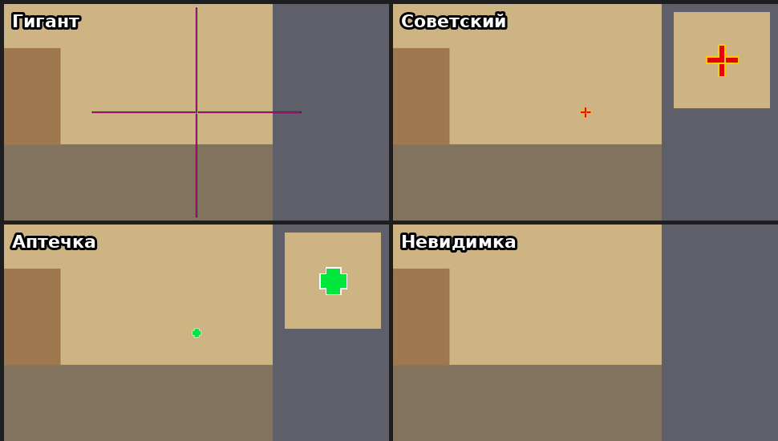
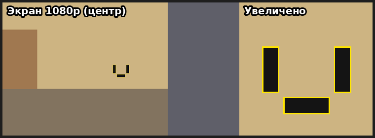

# Смешные прицелы для CS2 — коды для вставки (без установки программ)

После обновления CS2 от 30.09.2026 коды прицела начинаются с `CS` и состоят из 46 символов
без дефисов. Старые коды `CSGO-…` игра больше не принимает. Все коды ниже — нового формата.

**Как вставить:** *Настройки → Игра → Прицел (Crosshair/Scopes) → «Импорт» (Import / Share)* →
вставьте код (Ctrl+V) → подтвердите.

**Что увидит друг, когда наблюдает за вами:** ваш прицел, если у него включено «Показывать
прицел наблюдаемого игрока» (консоль: `cl_show_observer_crosshair 1`, обычно включено).


*(Превью нарисовано по параметрам, а не снято в игре: в игре может немного отличаться.)*

| Название | Код | Что это |
|---|---|---|
| **Гигант** — главный | `CSpOqzk4JT3XPyt9zHP4usNaSVkw3dKYxcbHsbpaRA4wYC` | Ярко-розовый крест с линиями по 255 пикселей — на полэкрана. Играть можно: линии тонкие, в центре точка |
| **Советский** | `CSuw9O9KR8yB5zwAtK7RxbcPHp8zeuzt7nEx5BAs2tCkHC` | Красный крест с золотой обводкой и точкой — цвета флага СССР |
| **Аптечка** | `CS8YzpkYEJmhtUYUONpaqNNaW7VUGUbWQLFrObjALx8txH` | Жирный зелёный плюс с белой обводкой, как вывеска аптеки. Закрывает голову врага вдалеке |
| **Невидимка** | `CShSVax4kTcGG3u3o4BLJviuZwvsvkQZNvP9MkHETeOSsc` | Прицела нет вообще. Друг: «как он целится?!» Играть очень тяжело |
| Золотая точка | `CS2qJC7XTeqkkN6a8XSjzfzGNvwtsfLzzHyzKODyve8CHE` | Маленькая золотая точка — для оверлея ☭ из `README.md` |

Серп и молот средствами игры сделать нельзя: прицел CS2 состоит только из готовых фигур
(крест, круг, квадрат, точка) с настройкой размеров и цветов, своей картинки нет.

Совет: перед импортом сохраните свой текущий код (кнопка «Поделиться»/Share в том же меню),
чтобы потом вернуть его.

## «Чё смотришь?» — прицел-лицо ▮_▮



Два высоких чёрных «глаза» и плоский «рот» с жёлтой обводкой — недовольная рожица, которая
смотрит на наблюдающего. Целиться нужно в пустое место между глазами («переносицу»).

```
CS3wdFbGWecwBNi8OKHj8rJiGAfJT4a6MDcVMr89Zxmyhi
```

Как это собрано: стиль «Статичный крест» (4), включён T-стиль — верхняя палочка убрана.
Толщина линий (32 px) больше длины (10 px), поэтому боковые палочки становятся вертикальными
прямоугольниками-глазами, а нижняя — горизонтальным ртом. Зазор 22 px разносит их от центра.

Экспериментальная версия на динамическом кресте (стиль 0): при беге и стрельбе зазор растёт,
и лицо «разъезжается» в стороны. В игре не проверено:

```
CSDTYHjXcpa7iZAU2PV2wGyOQX4HF4F4k7ddCpSbkS6Y9h
```

Консоль (если код не принимается):
`cl_crosshairstyle 4; cl_crosshair_t 1; cl_crosshair_length 10; cl_crosshair_thickness 32; cl_crosshair_gap 22; cl_crosshairdot 0; cl_crosshaircolor_r 20; cl_crosshaircolor_g 20; cl_crosshaircolor_b 20; cl_crosshaircolor_a 255; cl_crosshair_drawoutline 1; cl_crosshairoutline_r 255; cl_crosshairoutline_g 230; cl_crosshairoutline_b 0; cl_crosshairoutline_a 255; cl_crosshair_screen_height 1080`

## То же самое через консоль

Если код не принимается, вставьте строку в консоль (`~`):

- Гигант:
  `cl_crosshairstyle 4; cl_crosshair_length 255; cl_crosshair_thickness 2; cl_crosshair_gap 5; cl_crosshairdot 1; cl_crosshair_t 0; cl_crosshaircolor_r 255; cl_crosshaircolor_g 20; cl_crosshaircolor_b 180; cl_crosshaircolor_a 255; cl_crosshair_drawoutline 1; cl_crosshairoutline_r 0; cl_crosshairoutline_g 0; cl_crosshairoutline_b 0; cl_crosshairoutline_a 255; cl_crosshair_screen_height 1080`
- Советский:
  `cl_crosshairstyle 4; cl_crosshair_length 9; cl_crosshair_thickness 3; cl_crosshair_gap 3; cl_crosshairdot 1; cl_crosshair_t 0; cl_crosshaircolor_r 230; cl_crosshaircolor_g 0; cl_crosshaircolor_b 10; cl_crosshaircolor_a 255; cl_crosshair_drawoutline 1; cl_crosshairoutline_r 255; cl_crosshairoutline_g 205; cl_crosshairoutline_b 0; cl_crosshairoutline_a 255; cl_crosshair_screen_height 1080`
- Аптечка:
  `cl_crosshairstyle 4; cl_crosshair_length 10; cl_crosshair_thickness 10; cl_crosshair_gap 0; cl_crosshairdot 0; cl_crosshair_t 0; cl_crosshaircolor_r 0; cl_crosshaircolor_g 230; cl_crosshaircolor_b 60; cl_crosshaircolor_a 255; cl_crosshair_drawoutline 1; cl_crosshairoutline_r 255; cl_crosshairoutline_g 255; cl_crosshairoutline_b 255; cl_crosshairoutline_a 255; cl_crosshair_screen_height 1080`
- Невидимка:
  `cl_crosshairstyle 4; cl_crosshair_length 0; cl_crosshair_thickness 0; cl_crosshairdot 0; cl_crosshaircolor_a 0; cl_crosshair_drawoutline 0`

Коды собраны библиотекой [csgo-sharecode](https://www.npmjs.com/package/csgo-sharecode) 7.0.1
(формат `cs2-v1`) и проверены обратным разбором.
