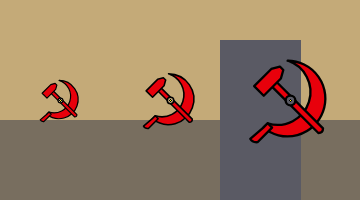

# Прицел ☭ (серп и молот) для Counter-Strike 2

> Нужен прицел без установки программ, который увидит наблюдающий друг? Смотрите [CODES.md](CODES.md).

## Что умеет сам CS2

Встроенный прицел CS2 (после обновления 30.09.2026) — это одна из готовых фигур: крест,
круг, квадрат, «квадранты» или точка (`cl_crosshairstyle` 0–9). Настраиваются длина
(`cl_crosshair_length`), толщина (`cl_crosshair_thickness`), зазор (`cl_crosshair_gap`) в пикселях,
точка, Т-образный вид, цвет и цвет обводки. Коды прицела (`CS…`) хранят те же параметры.
Своей картинки или произвольной формы в игре нет — **нарисовать ☭ средствами CS2 нельзя**.

Поэтому ☭ рисуется отдельной программой **поверх** игры (оверлей), а игра показывает
только маленькую точку в центре.

## Сравнение вариантов

| Вариант | Установка | Вид | Риск |
|---|---|---|---|
| Только настройки CS2 | Проще всего | ☭ невозможен, только линии/точка | Нет |
| **Этот скрипт (AutoHotkey + PNG)** — рекомендую | 5 минут, бесплатно, весь код виден | Точный ☭ | Скрипт не трогает игру; официальной гарантии Valve нет* |
| Crosshair X / HudSight (Steam, платные) | Купить, загрузить PNG | Точный ☭ | Тот же принцип оверлея; официальной гарантии тоже нет* |
| Наклейка на монитор | Наклеить | Неровно, мешает вне игры | Нет |

\* Valve не публикует список разрешённых оверлеев. Оверлей-окно не читает память игры и
не вмешивается в её процесс, и о банах VAC за такие программы данных нет — но это **не
официальная гарантия**. FACEIT и другие площадки со своим античитом могут запрещать
сторонние прицелы — проверьте их правила или не включайте оверлей там.

## Установка (Windows)

1. **Установите AutoHotkey v2** — бесплатная программа, которая запускает файл `.ahk`.
   Скачайте с официального сайта <https://www.autohotkey.com> (кнопка *Download → v2.0*)
   и установите с настройками по умолчанию.
2. **Скачайте эту папку** (`cs2-crosshair`) целиком: на GitHub — *Code → Download ZIP*,
   распакуйте. Файлы `.ahk` и `.png` должны лежать в одной папке.
3. **Включите режим окна без рамки в CS2**: *Настройки → Видео → Режим отображения →
   «Полноэкранный в окне»* (Fullscreen Windowed). В обычном полноэкранном режиме
   оверлеи не видны.
4. **Настройте точку в игре.** *Настройки → Игра → Прицел → Импорт* и вставьте код
   `CS2qJC7XTeqkkN6a8XSjzfzGNvwtsfLzzHyzKODyve8CHE`
   (или выполните команды из `crosshair-dot.cfg` в консоли `~`).
   Получится маленькая золотая точка — она видна в «окошке» в центре ☭ и показывает
   точное место выстрела.
5. **Запустите прицел**: двойной щелчок по `sickle-hammer-crosshair.ahk`.
   В центре экрана появится ☭, в трее — зелёный значок «H».
6. Запустите CS2 и проверьте на карте с ботами, что золотая точка игры видна точно
   в окошке ☭.

Управление: **F10** — показать/скрыть (например, при прицеливании в снайперку),
**Ctrl+F10** — закрыть скрипт.

## Подстройка

Откройте `sickle-hammer-crosshair.ahk` в Блокноте (правый клик → *Изменить*):

- `Size := 65` — размер: `49` (маленький), `65` (средний), `97` (крупный).
- `OffsetX`/`OffsetY` — если точка игры не в окошке, сдвиньте ☭ на 1–2 пикселя.

Если у вас несколько мониторов, ☭ появится в центре основного — играйте на нём.
Масштабирование Windows (125 %, 150 %) учтено. Растянутое разрешение в режиме
«Полноэкранный в окне» тоже не мешает: игра всё равно растягивается на весь экран,
и центр совпадает.

## Файлы

- `sickle-hammer-49.png`, `-65.png`, `-97.png` — прозрачные картинки ☭ (центр = центр картинки).
- `sickle-hammer.svg` — исходник символа; из него можно сделать PNG любого размера
  (размер лучше брать нечётный — тогда центр приходится ровно на пиксель).
- `sickle-hammer-crosshair.ahk` — скрипт оверлея.
- `crosshair-dot.cfg` — настройки точки встроенного прицела.
- `CODES.md`, `codes-preview.png` — смешные прицелы-коды для импорта прямо в игре.
